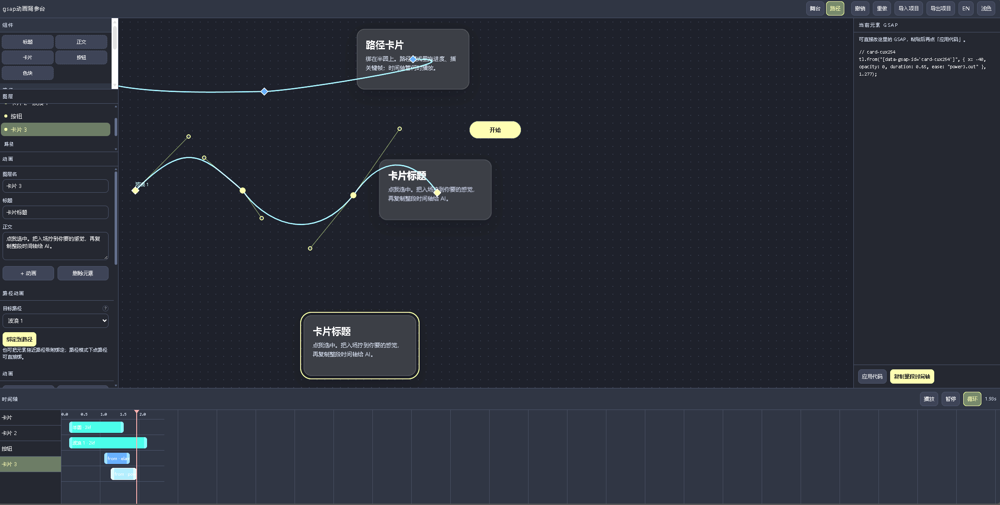

# GSAP Motion Desk

Visual GSAP playground: stage blocks, motion paths, pose keyframes, and a master timeline — then export readable GSAP code.

可视化 GSAP 调参台：舞台组件、运动路径、姿态关键帧与主时间轴，一键导出可读的 GSAP 代码。

### 要解决的事 / Why

vibe coding 时代还在为跟 AI 说「XX 那种感觉」，AI做出来对不上而烦恼？用这个台子自己把节奏拧准，再把**整段 GSAP 时间轴**复制回对话。  
**一切所见即所得。**

Tired of telling an AI “make it feel like XX” and getting something that never quite matches? Dial the motion yourself on this desk, then paste the **full GSAP timeline** back into the chat.  
**What you see is what you get.**



## Features / 功能

- **Stage / 舞台** — drop headings, cards, buttons, boxes; edit on canvas  
  拖入标题、卡片、按钮、色块，画布上直接改内容
- **Paths / 路径** — line / arc / semicircle / wave; drag center, radius, Bézier handles  
  直线 / 弧 / 半圆 / 波浪预设；拖圆心、半径、贝塞尔句柄
- **Path motion / 路径动画** — bind to a path; scrub progress; pose keyframes (rotation, scale, opacity…)  
  元素绑路径；拖进度；插入姿态关键帧（旋转、缩放、透明度…）
- **Timeline / 时间轴** — schedule path motions and clips; trim start / duration  
  编排路径动画与 clip；裁切开始时间与时长
- **Export / 导出** — copy GSAP + MotionPathPlugin code; JSON import / export  
  复制 GSAP 代码；项目 JSON 导入导出
- **i18n** — English / 中文 toggle  
  中英切换

## Run / 运行

No build step. Open `index.html`, or serve the folder:

无需构建。直接打开 `index.html`，或本地起静态服务：

```bash
npx serve .
# or: python -m http.server 5173
```

Then open the printed local URL.  
在终端打印的本地地址打开即可。

## Stack / 技术栈

Vanilla JS + [GSAP](https://gsap.com/) + MotionPathPlugin (`js/vendor/`).

纯前端 + GSAP（vendor 已内置）。

## License / 许可

**Dual license / 双授权** — see [LICENSE](LICENSE):

1. **GPL-3.0** ([LICENSE-GPL-3.0](LICENSE-GPL-3.0)) — free use, modify, and redistribute under GPL terms (source must stay open if you distribute).  
   **GPL-3.0**：可免费使用、修改、分发；若对外分发，须按 GPL 开源 reciprocal。
2. **Commercial** — closed-source / proprietary products, or terms without GPL obligations: open a GitHub Issue titled `Commercial license` (or email listed on the repo).  
   **商业许可**：闭源产品、不想受 GPL 约束时，开 Issue（标题 `Commercial license`）或按仓库留下的邮箱联系作者购买。

Vendored GSAP files under `js/vendor/` remain subject to [GSAP’s own license](https://gsap.com/community/standard-license/).  
`js/vendor/` 内的 GSAP 仍遵循 GSAP 自身许可。
